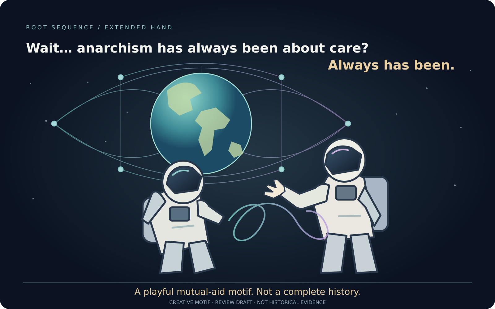

# Always Has Been: Creative Motifs

**Role:** Two original vector meme studies, not historical evidence. 
**Status:** AI-assisted review drafts, 2026-10-26; wording and images remain pending author review; GitHub draft sharing authorized. 
**Research home:** [Coercion, Care, and the Extended Hand](README.md).

## 1. The offered hand

**First astronaut:** “Wait… freedom needs care?” 
**Second astronaut, extending an open hand:** “Always has been.”

The open glove replaces the familiar threatening gesture in the astronaut meme. The other astronaut can turn toward it, decline it, or keep looking. The web suggests interdependence; the eye suggests shared awareness. Neither is intended as an all-seeing authority. The infinity line suggests an ongoing relationship capable of revision, not a sealed destiny or compulsory bond.

The footer matters: **“An offered hand must be possible to refuse.”** Without it, an attractive image of care can hide the same problem the research is trying to examine.

## 2. The separate meta-meme

**First astronaut:** “Wait… anarchism has always been about care?” 
**Second astronaut, extending an open hand:** “Always has been.”

This is the requested affectionate recognition joke about mutual aid. It is not a claim that every anarchist tradition, person, or historical episode has centered care, or that care belongs exclusively to anarchism. A [historical intellectual route](sources.md) can support a more careful discussion; a punchline cannot supply one.

## Provenance, accessibility, and reuse

Rae supplied the astronaut-hand inversion, the eye/web/infinity direction, and the separate care meta-meme. Codex drew original SVG artwork and drafted the first meme's question and both explanatory footers. No screenshot, astronaut photograph, logo, or existing meme image was copied. The generic “Always has been” format is the cultural reference; no original creator attribution or ownership claim is invented.

The user-supplied network SVG informed the request's visual context but is not embedded or redistributed. These new drawings use ordinary geometric imagery, not a claim to any Indigenous symbol or tradition. SVG titles, descriptions, readable text, and the alternative text above preserve meaning beyond the image.

The repository's [license](../../license) applies to original contributions where rights permit; it cannot grant rights in external works. These are draft artifacts, not an approved organization logo or released campaign. The history, principle, and [tests](simulation-proposals.md) remain independently contestable even if the image resonates.
