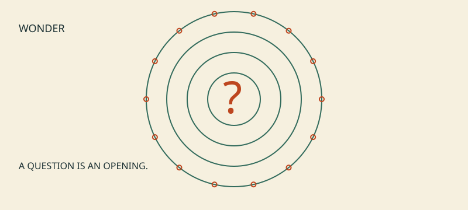
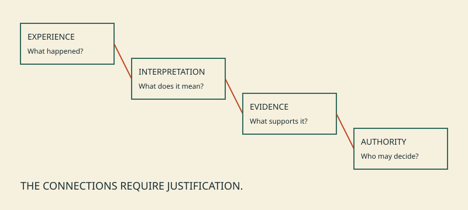
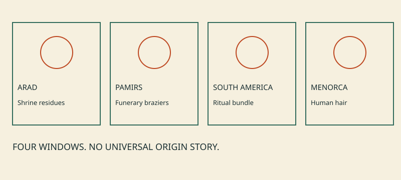
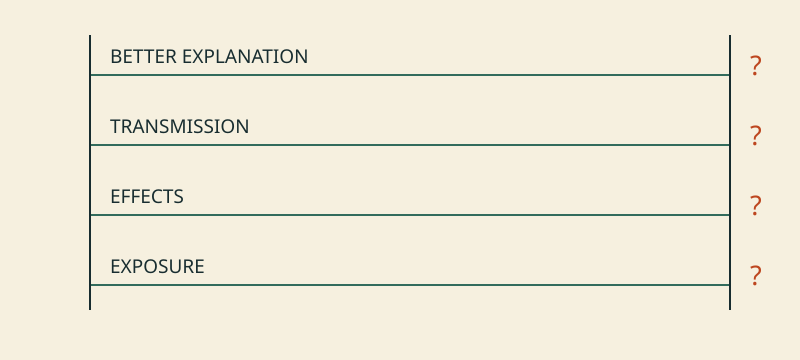
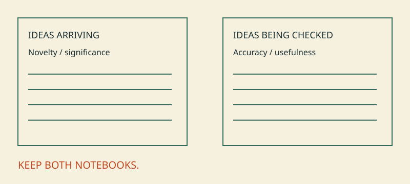
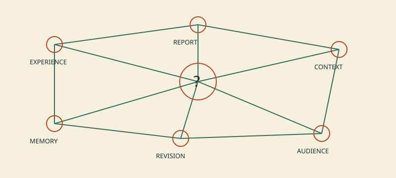
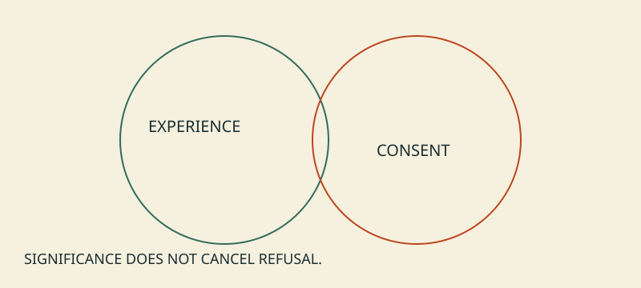
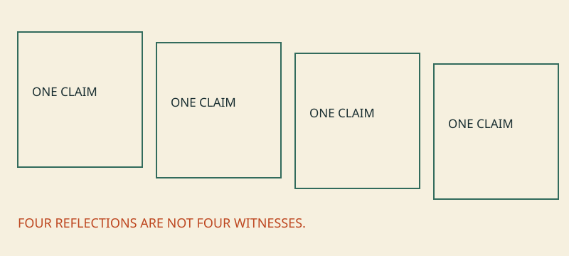

# The Stoned Age — reader edition

## The Stoned Age

*Altered States, Human Curiosity, and the Long History of Making Meaning*

A small book about large experiences—and what happens after someone says, “I have figured it all out.”

Companion provocation: How Drugs Explain the Universe.

Root Sequence · illustrated reader edition · v0.1.1 · 14 October 2026

AI-assisted draft. Author, scholarly and cultural review pending. The illustrations are original conceptual diagrams, not historical reconstructions.

---

## Please turn to page 666

*The universe has not supplied a foreword.*

There is a particular kind of book that promises to explain everything. By chapter three it has explained religion, language, consciousness and your difficult uncle. By chapter four, the footnotes have quietly left the building.

This is a book about resisting that temptation without losing the question that made it exciting. What happens when experience changes enough that the familiar becomes strange? Why does an idea sometimes feel discovered rather than invented? What happens when somebody else believes it too?

Drugs can be part of that inquiry. They do not get to be the answer in advance. We are interested in the long history of making meaning, including the places where a wonderful story outruns what anybody can actually show.

The joke opens the door. Curiosity gets to stay after the joke is over.

---

## A feeling is an event

*An explanation is another event.*

Imagine waking from a dream certain that you have solved a problem. There are several things worth recording: the dream happened; it felt important; you remember an answer; the answer might work.

Those are different claims. Testing the answer does not erase the dream. Respecting the dream does not oblige anyone to accept the answer.

This is our working distinction throughout the book: experience, interpretation, evidence and authority. It applies to a vision, a sudden insight, a compelling argument and an AI-generated explanation. It does not mean they share one mechanism.

A person can be the best witness to how something felt without being the final authority on what caused it. A scientist can identify a mechanism without exhausting what an experience means to the person. Those two forms of humility can coexist.

---

## Things that actually survived

*Archaeology cannot interview the smoke.*

At Arad, researchers detected residues consistent with cannabis and frankincense on different shrine altars. In the Pamirs, cannabis-related residues appeared in funerary braziers. These are local findings, not an origin story for all religion. [S01, S02]

A South American ritual bundle contained evidence of multiple psychotropic plants. Ancient hair from Menorca yielded ephedrine, atropine and scopolamine. Containers and human tissue answer different questions. [S03, S04]

What survives sets limits on what can be said. An object may tell us that material was present. It may not reveal who used it, how they felt, or which story they told afterward.

The strongest historical writing preserves that asymmetry. We can know something without knowing everything around it. Uncertainty is not an empty space that a sufficiently good illustrator is entitled to fill.

---

## Not one substance. Not one culture.

*A category is not a ceremony.*

“Drugs” is an enormous label. Classic psychedelics have important pharmacological features in common, but psychoactive substances do not all work alike. Cannabis, psilocybin and the alkaloids detected in Menorca are not interchangeable. [S04, S05]

Nor are the people. A particular shrine, burial practice, living Indigenous tradition and modern laboratory session require their own histories. A sacred name is not decorative packaging for a molecule.

We have deliberately left several tempting stories unwritten. This edition cannot responsibly identify Soma, reconstruct Eleusinian preparations or narrate every mushroom tradition. Those chapters need sources and people with the relevant expertise.

A living book is allowed to have a boundary. In fact, that may be how it stays alive: by knowing which questions it has not yet earned the right to answer.

---

## The ape needs more evidence

*A good origin story is still a claim.*

The strongest “stoned ape” story needs to establish ancient exposure, consequential effects, evolutionary transmission and an advantage over rival explanations. No single modern experience supplies that chain.

A published psychedelic-evolution hypothesis offers possible pathways, while acknowledging the gap in direct evidence for ancient psychedelic mushroom ingestion. It is a proposal to investigate. [S09]

Something can be biologically possible, historically plausible and still unestablished. These words are not evasions. They mark different stages of knowing.

Our question survives the grand story failing: how might particular altered-state practices affect particular communities? The answer could involve learning, memory, power, harm, pleasure, care, or combinations that refuse to fit on a motivational poster.

---

## The idea feels brilliant

*That is useful information about the feeling.*

In one controlled study, acute feelings of creative insight increased while deliberate creativity-task performance decreased; at seven days, self-rated novelty increased but convergent thinking remained lower. “New to me” is not independently verified originality. [S07]

Imagine two notebooks. One holds ideas as they arrive. The other records what happened when they were checked. Neither notebook should swallow the other.

If we demand that every new thought arrive fully proved, we will lose good questions. If we treat the arrival of a thought as its proof, we will keep bad answers. Research needs room for surprise and a return visit.

“Come back to this tomorrow” is not necessarily an insult to revelation. It can be an act of care toward an idea that deserves better than immediate worship or immediate disposal.

---

## Meaning without a cosmic certificate

*Something can matter without explaining everything.*

Supported psilocybin research has documented enduring reports of personal and spiritual significance. Acute fear also occurred in this small, screened sample. Such reports do not verify the metaphysical content of an experience. [S06]

A moment may change what someone values. That is already substantial. It does not need to settle the structure of the cosmos to deserve attention.

Our mistake is often demanding too much of meaning. We ask a moving experience to become a theory, then ask the theory to authorize a way of life for everyone else. At each step, a different kind of justification is needed.

Here is a smaller possibility: an experience helps a person ask a more careful question. The question leads to a conversation. The conversation changes a practice. No universal secret is required.

---

## Nobody makes meaning alone

*The audience is part of the story.*

Cultural research connects reported spiritual presence with models of mind and absorption. Cultural-evolution work asks how innovation depends on transmission and recombination. Neither requires one chemically inspired founder. [S10, S11]

Our editorial map is experience, report, interpretation, circulation, stabilization and revision. It is a way to ask questions, not a law of history.

Which reports get repeated? Who can object? Does agreement reflect independent checking, or everyone borrowing from the same storyteller? What is lost when an ambiguous account becomes an official version?

A story can make a community feel connected. That feeling is not, by itself, evidence that the community's decisions are good. Belonging and correction need to be able to share a room.

---

## Who owns the explanation?

*Wonder does not cancel consent.*

The Indigenous Peyote Conservation Initiative asks that peyote questions remain grounded in Indigenous cultural perspectives rather than simply folded into generalized drug reform. Its position should be read on its own terms. [S14]

For this project, the implication is an editorial responsibility: do not borrow sacred imagery as atmosphere; do not confuse a public account with permission to reproduce everything; do not ask one person to stand for a continent.

The same principle works at an individual scale. A person should be able to reject someone else's interpretation of their experience. Distress should not have to become a redemption story to be heard.

Research on challenging psychedelic experiences includes negative consequences as well as positive interpretations. Its survey design does not tell us population-wide rates. [S13] A serious book leaves room for experiences that do not resolve beautifully.

---

## The oracle has autocomplete

*A polished response is not an independent witness.*

Research has found sycophancy in tested language models: a tendency, in some settings, to agree with users instead of prioritizing truth. That finding has limits, but it gives us a concrete problem to examine. [S15]

An AI can help arrange a difficult thought into readable prose. It can also make an unfinished interpretation sound complete. Our comparison is about how people assign authority to compelling accounts. We are not claiming that a model has a psychedelic experience.

This book was developed with AI assistance. Its fluency is therefore something to inspect, not a reason to trust it. The sources and open questions are part of the work, not administrative furniture left at the back.

The helpful response to a large idea may be: preserve it, separate its claims, and find out what would change your mind.

---

## Leave the door open

*Curiosity deserves better than certainty on arrival.*

The Stoned Age is an invitation to investigate, not a recommendation to take a substance. You do not need an altered state to participate.

Start with one claim. Ask what kind it is. Find the source. Notice the difference between what was measured and what was inferred. Ask who is absent from the account. Make room for a result that disappoints the original story.

Root Sequence coordinates the questions and their translations. Archaeology, pharmacology, anthropology, history, philosophy and AI research retain the methods and expertise that make their claims assessable.

The next edition should be better because something changed: a source was corrected, a counterexample taken seriously, a cultural chapter written with appropriate expertise, an attractive claim retired.

Keep the joke. Keep the question. Let the answer remain answerable.

## References

See the [shared source register](../research/sources.md) and [appraisal](../research/appraisal.md).
